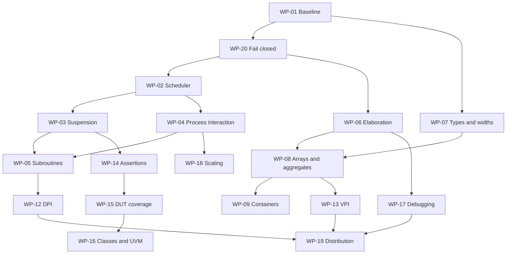

> October 27 worktree update: WP-01–05 have qualified implementation slices in [timed execution](timed-execution.md), including implicit sensitivity, runtime identifier assignment delays, conservative hazard diagnostics and automatic subroutine additions. All broad packages remain open; the audit-time evidence below is historical.

> Live tracker: [GitHub epic #1](https://github.com/jeffadickson/VeloSim/issues/1); all 20 packages have open GitHub issues. The checklist in the epic reflects issue completion; this document is the audit-time scope specification.

# Verilator gap work packages

Audit source and capability matrix: [verilator-gap-analysis.md](verilator-gap-analysis.md). Structured index: [verilator-work-packages.json](verilator-work-packages.json). Product behavior is not changed by this plan. All packages start open; new acceptance details are inferred/draft, not verified requirement closure. Existing source changes are preserved and uncommitted.

Every implementation package must retain original-source fixtures, independent expected results where references differ, negative/malformed and property/randomized cases, reproducible seeds/minimized failures where applicable, relevant maintained fuzz/mutation tooling, implementation line/branch coverage with scope, bounded parallel builds and versioned evidence. Use C#/F# helpers by default and NativeAOT where practical. Prefer existing libraries; custom code supplies HDL semantics. Preserve CI policy. Update root prompt.md before any future commit. Expert-perspective reviews must be labeled simulated unless humans actually participate.

No new code/HDL suite was run beyond the fourteen frontend acceptance probes for this audit; historical test results are labeled in the analysis. Coverage thresholds and exact new feature requirements must be specified per vertical slice rather than invented from the matrix.

## Integration graph

The graph shows the main integration path; exact dependency lists below and in JSON are authoritative and include additional edges. WP-10 system tasks and WP-11 net resolution can start scoped work before all broad integration gates close.

## WP-01

**Pin the comparison baseline and qualify existing capabilities** — P0, scope M, status Open / proposed.

Publish a source-hashed capability baseline; preserve Verilator 5.020 as a legacy reference and add a separately pinned 5.052 reference environment. Qualify the current associative slice before extending it; reconcile stale capability descriptions.

Dependencies: none. Product requirements: `VS-QUAL-001`, `VS-RTL-ASSOCIATIVE-001`, `VS-RTL-QUEUE-001`. Stable planning ID: `VS-PLAN-WP-01`.

Current evidence: docs/associative-arrays.md; native/rtl/runtime.h; current focused run 14/14 managed and 1/1 native (historical to this audit).

Tasks:

- [ ] Record exporter, generated model, frontend, compiler and reference versions/hashes; label worktree-only capabilities.
- [ ] Replay existing associative/queue cases against each pinned reference and an independent oracle; retain disagreements as minimized cases.
- [ ] Run relevant regressions, native sanitizer/coverage and Stryker.NET/property checks for the associative/frontend changes; report survivors and excluded scopes.
- [ ] Make README/roadmap point to the authoritative current matrix and preserve historical reports.

Acceptance: A reproducible baseline report names every tested source hash, distinct pass/fail/skip counts, line/branch scope and known oracle differences. No broad requirement is closed from focused passes.

Likely implementation paths: `docs/associative-arrays.md`, `tests/VeloSim.Tests/RtlIndexedConformanceTests.cs`, `tools/`, `requirements/velosim.sdoc`.

GitHub: [#2 — WP-01](https://github.com/jeffadickson/VeloSim/issues/2).

Library opportunities: [LIB-05 — .NET BigInteger and ordered collections as independent references](library-opportunities.md#lib-05); [LIB-09 — Process execution: retain BCL first, evaluate CliWrap narrowly](library-opportunities.md#lib-09); [LIB-15 — Reuse the existing verification ecosystem](library-opportunities.md#lib-15). Recommendations and acceptance checks are also in the GitHub issue; no new dependency has been adopted.

## WP-02

**Implement the timed scheduler and region semantics** — P0, scope XL, status Open / proposed.

Add an executing HDL scheduler rather than extending the opaque-ID transport claim. Define time precision, active/inactive/NBA ordering, reactivation and explicit supported region boundaries.

Dependencies: WP-01, WP-20. Product requirements: `VS-RTL-TIME-001`, `VS-RTL-EVENT-TRANSPORT-001`. Stable planning ID: `VS-PLAN-WP-02`.

Current evidence: native/rtl/timed_events.h transports IDs only; Model::timeInc advances host time without HDL suspension.

Tasks:

- [ ] Specify time-unit conversion, overflow, zero-delay ordering and active/inactive/NBA fixpoint behavior.
- [ ] Implement copyable process/event state using standard containers, sampled NBA payloads/addresses and deterministic ordering only where the language permits.
- [ ] Integrate model time jumps, pending-event queries, quiescence, budgets and full failure rollback.
- [ ] Add independent region-order tests, same-source timing comparisons and rejected/out-of-scope region diagnostics.

Acceptance: Directed traces cover #0 before NBA, NBA reactivation, simultaneous clocks, sampled delayed addresses, overflow, exhausted budgets and rollback. Host input changes at a future tick cannot leak into earlier queued events.

Likely implementation paths: `native/rtl/timed_events.h`, `native/rtl/external_model.h`, `src/VeloSim.Core/RtlDesign.cs`, `src/VeloSim.Core/RtlExternalSdk.cs`.

GitHub: [#3 — WP-02](https://github.com/jeffadickson/VeloSim/issues/3).

Library opportunities: [LIB-07 — Standard event storage and explicit suspended-process state](library-opportunities.md#lib-07); [LIB-12 — Versioned checkpoint serialization](library-opportunities.md#lib-12); [LIB-17 — SystemC as an optional adapter and selected independent reference](library-opportunities.md#lib-17). Recommendations and acceptance checks are also in the GitHub issue; no new dependency has been adopted.

## WP-03

**Lower suspended HDL processes, delays, waits and fork control** — P0, scope XL, status Open / proposed.

Connect typed UHDM/IR suspension points to the scheduler: procedural and intra-assignment delays, event expressions, wait, internal clocks, named events and fork/join families.

Dependencies: WP-02. Product requirements: `VS-RTL-TIME-001`, `VS-RTL-PROC-001`. Stable planning ID: `VS-PLAN-WP-03`.

Current evidence: rtl_flatten.h input_events requires direct scalar top-input edges; rtl.cpp statement lowering has no resumable delay/wait cases.

Tasks:

- [ ] Add explicit resumable process frames and typed delay/event/wait IR nodes; retain original source locations.
- [ ] Support multiple timed initial/always processes, timeunits/timeprecision and internal generated clocks.
- [ ] Implement fork/join, join_any/join_none, wait fork and disable fork incrementally with stated process-lifetime rules.
- [ ] Reject unsupported timing/net-delay forms explicitly; preserve model state and pending events on failure.

Acceptance: Same-original-file comparisons exercise producer/consumer handshakes, internal oscillators, delay quantization, wait rearming, nested suspension and fork cancellation; minimized ordering cases have independent expected traces.

Likely implementation paths: `native/uhdm/rtl.cpp`, `native/uhdm/rtl_flatten.h`, `src/VeloSim.Core/RtlDesign.cs`, `src/VeloSim.Core/RtlInitialization.cs`.

GitHub: [#4 — WP-03](https://github.com/jeffadickson/VeloSim/issues/4).

Library opportunities: [LIB-01 — UHDM generated visitors/listeners](library-opportunities.md#lib-01); [LIB-07 — Standard event storage and explicit suspended-process state](library-opportunities.md#lib-07). Recommendations and acceptance checks are also in the GitHub issue; no new dependency has been adopted.

## WP-04

**Support interacting processes, combinational settling and latches** — P1, scope L, status Open / proposed.

Move beyond isolated blocking writers and an acyclic whole-word DAG, retaining a documented race policy. Support concurrent startup, legal latch storage, level sensitivity and change-driven reactivation.

Dependencies: WP-02. Product requirements: `VS-RTL-EVENT-001`, `VS-RTL-BLOCK-004`, `VS-RTL-COMB-001`, `VS-RTL-INIT-001`. Stable planning ID: `VS-PLAN-WP-04`.

Current evidence: RtlCombinational.SortCombinational rejects feedback/clock dependencies; ValidateCombFlow requires whole-word fully assigned destinations; initializer frontend permits one initial block.

Tasks:

- [ ] Specify blocking visibility/NBA interactions and diagnose actual races without rejecting all cross-process communication.
- [ ] Implement multiple initial processes and always_comb startup/sensitivity under the scheduler.
- [ ] Add always @*, arbitrary level sensitivity, always_latch and selected/array combinational writes.
- [ ] Support bounded settle-to-quiescence with feedback/nonconvergence diagnostics and source attribution.

Acceptance: Interacting RTL examples match independent expectations and applicable references; nonconverging/racy examples are diagnosed without claiming a unique IEEE-required ordering.

Likely implementation paths: `src/VeloSim.Core/RtlCombinational.cs`, `src/VeloSim.Core/RtlInitialization.cs`, `src/VeloSim.Core/RtlDesign.cs`, `native/uhdm/rtl_flatten.h`.

GitHub: [#5 — WP-04](https://github.com/jeffadickson/VeloSim/issues/5).

Library opportunities: [LIB-07 — Standard event storage and explicit suspended-process state](library-opportunities.md#lib-07); [LIB-14 — oneTBB / standard bounded parallelism](library-opportunities.md#lib-14). Recommendations and acceptance checks are also in the GitHub issue; no new dependency has been adopted.

## WP-05

**Expand functions and tasks beyond pure zero-time inlining** — P1, scope XL, status Open / proposed.

Add stateful/static and timed tasks, broader argument modes and runtime control flow without losing declared conversion or lifetime semantics.

Dependencies: WP-03, WP-04. Product requirements: `VS-RTL-FUNC-001`, `VS-RTL-TASK-001`, `VS-RTL-FLOW-001`, `VS-RTL-PARAM-001`, `VS-RTL-PROC-001`. Stable planning ID: `VS-PLAN-WP-05`.

Audit evidence (October 26, historical): rtl_subroutines.h required automatic calls, rejected nested tasks/ref formals and runtime-dependent function trip counts, and capped combined task outputs at128 bits.

Current scoped progress: automatic local initialization, early task return, whole-word nested value-result tasks/inout copy-out and input defaults with positional/named omissions. The current combined-output budget is256 bits. Constant calls used in widths apply supported defaults through the existing UHDM evaluator. Protocol v4 requires re-elaboration and withholds successful provenance after frontend errors. See the source-bound [argument qualification report](../verification/wp05-arguments-20261028.json); the broad package remains open. Task-hidden sensitivity remains outside this qualification; declaration-scope tests explicitly stimulate another call.

Tasks:

- [ ] Support runtime-dependent loops, break/continue and selected/local aggregate writes within functions.
- [ ] Add named/default arguments, inout/ref/const-ref, arrays/aggregates and nested task calls with alias rules.
- [ ] Implement static storage, captured globals, hierarchical calls and bounded recursion with explicit frame lifetimes.
- [ ] Connect timed task calls to suspended processes and qualify broader output widths beyond the current256-bit combined budget. Historical128-bit restriction has been superseded by the ABI2 copy-out slice.

Acceptance: Tests distinguish pass-by-value from ref aliasing, automatic from static lifetime, early return and recursive limits; timed calls resume correctly and existing pure-call cases stay compatible.

Likely implementation paths: `native/uhdm/rtl_subroutines.h`, `native/uhdm/rtl.cpp`, `src/VeloSim.Core/RtlConversion.cs`.

GitHub: [#6 — WP-05](https://github.com/jeffadickson/VeloSim/issues/6).

Library opportunities: [LIB-01 — UHDM generated visitors/listeners](library-opportunities.md#lib-01); [LIB-19 — Typed frontend metadata for SVA, aggregates and procedural lowering](library-opportunities.md#lib-19). Recommendations and acceptance checks are also in the GitHub issue; no new dependency has been adopted.

## WP-06

**Complete elaboration namespaces, hierarchy and interface connections** — P1, scope XL, status Open / proposed.

Preserve Surelog/UHDM as the elaborator; expand execution lowering for packages/imports, parameter expressions, interfaces/modports and richer hierarchy/ports.

Dependencies: WP-01, WP-20. Product requirements: `VS-RTL-HIER-001`, `VS-RTL-PARAM-001`. Stable planning ID: `VS-PLAN-WP-06`.

Current evidence: rtl_flatten.h rejects open/unresolved, inout and memory instance ports; parameter capture contract only accepts known literal/unary-literal values.

Tasks:

- [ ] Audit package/type/value namespaces, instance arrays, nested generate scopes and hierarchical variable/function/task references by declaration identity.
- [ ] Support compound constant expressions, parameter selections and type parameters without trusting lossy folded values.
- [ ] Add legal open ports, selected/aggregate/unpacked ports, inout binding and interfaces/modports.
- [ ] Evaluate bind/program/clocking/virtual-interface forms individually; explicitly diagnose unsupported cases and add multi-file include/macro tests.

Acceptance: Multi-file same-source designs preserve shadowing, distinct parameter overrides, generated scope names and port conversion; supported parsing alone never counts as executable capability.

Likely implementation paths: `native/uhdm/rtl_flatten.h`, `native/uhdm/rtl_subroutines.h`, `src/VeloSim.Core/SurelogFrontend.cs`, `src/VeloSim.Core/SlangFrontend.cs`.

GitHub: [#7 — WP-06](https://github.com/jeffadickson/VeloSim/issues/7).

Library opportunities: [LIB-01 — UHDM generated visitors/listeners](library-opportunities.md#lib-01); [LIB-06 — Use established JSON serializers instead of structural string assembly](library-opportunities.md#lib-06); [LIB-19 — Typed frontend metadata for SVA, aggregates and procedural lowering](library-opportunities.md#lib-19). Recommendations and acceptance checks are also in the GitHub issue; no new dependency has been adopted.

## WP-07

**Broaden expressions, numeric types and packed word sizes** — P1, scope L, status Open / proposed.

Remove the fixed 256-bit boundary deliberately and add missing typed expression families; treat real arithmetic as a separate numeric model rather than an integer approximation.

Dependencies: WP-01. Product requirements: `VS-RTL-WORD-256-001`, `VS-RTL-INTEGER-001`, `VS-RTL-TYPE-001`. Stable planning ID: `VS-PLAN-WP-07`.

Current evidence: RTL validation/runtime cap words256; independent IR remains64-bit. Existing byte/shortint/int/longint/integer/time and bounded enums are implemented.

Tasks:

- [ ] Inventory unsupported casts, fill literals, streaming concatenation, assignment expressions, wildcard equality/inside and system bit/count queries.
- [ ] Implement flexible packed declaration bounds, signed indices/conversions and words beyond256 bits with matched host/VPI representation.
- [ ] Add real/shortreal, string and handle type contracts or explicit scoped rejections; define numerical conversion/rounding.
- [ ] Reconcile legacy64-bit independent IR with structural RTL capabilities without implying they already share a representation.

Acceptance: Independent BigInteger/bit-string oracles and multiple frontends cover widths255/256/257/512/1024, X/Z, signed overflow and casts; ABI changes are versioned and old hosts fail clearly.

Likely implementation paths: `native/rtl/runtime.h`, `native/uhdm/rtl.cpp`, `native/uhdm/rtl_types.h`, `src/VeloSim.Core/RtlDesign.cs`, `native/rtl/external_model.h`.

GitHub: [#8 — WP-07](https://github.com/jeffadickson/VeloSim/issues/8).

Library opportunities: [LIB-02 — slang::SVInt for four-state arithmetic](library-opportunities.md#lib-02); [LIB-03 — Boost.Multiprecision or LLVM APInt as numeric alternatives](library-opportunities.md#lib-03); [LIB-05 — .NET BigInteger and ordered collections as independent references](library-opportunities.md#lib-05); [LIB-15 — Reuse the existing verification ecosystem](library-opportunities.md#lib-15). Recommendations and acceptance checks are also in the GitHub issue; no new dependency has been adopted.

## WP-08

**Expand aggregates, array shapes and whole-array operations** — P1, scope L, status Open / proposed.

Add unpacked/mixed-state aggregates, assignment patterns and array operations beyond bounded scalar elements.

Dependencies: WP-06, WP-07. Product requirements: `VS-RTL-PACKED-001`, `VS-RTL-ARRAY-SHAPE-001`, `VS-RTL-ARRAY-001`. Stable planning ID: `VS-PLAN-WP-08`.

Current evidence: Current packed aggregates require uniform state, untagged equal-width unions; fixed arrays rank1..4, nonnegative bounds, total256 cells.

Tasks:

- [ ] Define unpacked structures/unions, tagged forms and aggregate layout/state conversion; retain explicit diagnostics for unsupported forms.
- [ ] Support whole-array assignments, slices, foreach and aggregate argument/port transport.
- [ ] Extend negative/unusual dimension bounds, rank limits, shape conversions and packed multidimensional declarations.
- [ ] Add aggregate/container nesting and alias/copy semantics using typed storage rather than flattening away lifetime.

Acceptance: Tests verify member layout independently, array direction/bounds, deep-copy behavior and malformed shape rejection; resource limits become explicit configurable contracts.

Likely implementation paths: `native/uhdm/rtl_types.h`, `native/uhdm/rtl_flatten.h`, `src/VeloSim.Core/RtlArrays.cs`.

GitHub: [#9 — WP-08](https://github.com/jeffadickson/VeloSim/issues/9).

Library opportunities: [LIB-01 — UHDM generated visitors/listeners](library-opportunities.md#lib-01); [LIB-02 — slang::SVInt for four-state arithmetic](library-opportunities.md#lib-02); [LIB-04 — Consolidate standard-library container adapters](library-opportunities.md#lib-04); [LIB-19 — Typed frontend metadata for SVA, aggregates and procedural lowering](library-opportunities.md#lib-19). Recommendations and acceptance checks are also in the GitHub issue; no new dependency has been adopted.

## WP-09

**Finish dynamic, associative and queue language semantics** — P1, scope L, status Open / proposed.

Extend the existing working bounded container slices rather than reimplementing storage. Close language-level method, lifetime, copy and ownership gaps.

Dependencies: WP-01, WP-08. Product requirements: `VS-RTL-ASSOCIATIVE-001`, `VS-RTL-QUEUE-001`, `VS-RTL-DYNAMIC-ARRAY-001`, `VS-RTL-ARRAY-001`. Stable planning ID: `VS-PLAN-WP-09`.

Current evidence: Current integral associative worktree slice passes focused14+native1; queues/dynamic arrays remain module-scope1D and capped256.

Tasks:

- [ ] Add string/wildcard associative keys, foreach, nested values, default patterns and broader key/value types.
- [ ] Add dynamic-array cross-array initialization/copy, nested dimensions and lifetime-safe references.
- [ ] Add queue insert, slices/$ indexing, bounded queue declarations/truncation, concatenation and array methods.
- [ ] Implement locator/order/reduction methods and configurable capacity; qualify signed/absent-key/missing-read behavior independently of the legacy reference.

Acceptance: Each method has typed same-source positive/negative cases, independent container expectations, overflow atomicity and rollback; no test exclusion is mislabeled as Verilator agreement.

Likely implementation paths: `native/rtl/runtime.h`, `src/VeloSim.Core/RtlAssociative.cs`, `src/VeloSim.Core/RtlQueues.cs`, `src/VeloSim.Core/RtlArrays.cs`, `native/uhdm/rtl.cpp`.

GitHub: [#10 — WP-09](https://github.com/jeffadickson/VeloSim/issues/10).

Library opportunities: [LIB-04 — Consolidate standard-library container adapters](library-opportunities.md#lib-04); [LIB-05 — .NET BigInteger and ordered collections as independent references](library-opportunities.md#lib-05); [LIB-15 — Reuse the existing verification ecosystem](library-opportunities.md#lib-15). Recommendations and acceptance checks are also in the GitHub issue; no new dependency has been adopted.

## WP-10

**Implement HDL system tasks, strings, real values and file I/O** — P1, scope L, status Open / proposed.

Make ordinary self-checking testbenches usable: diagnostics, termination, time queries, plusargs, memory files, formatted text and reproducible random functions.

Dependencies: WP-03, WP-07. Product requirements: `VS-RTL-PROC-001`, `VS-RTL-TYPE-001`. Stable planning ID: `VS-PLAN-WP-10`.

Current evidence: rtl.cpp accepts only a narrow system-function whitelist and has no general system-task runtime; host trace printing is not HDL $display support.

Tasks:

- [ ] Implement $display/$write/$strobe/$monitor, $finish/$stop/$fatal/$error with correct execution region and exit results.
- [ ] Add $time/$realtime and timescale formatting; string operations and numeric formatting/conversion.
- [ ] Add plusargs and $readmemh/$readmemb plus file open/read/write/scan with checked failures and deterministic paths.
- [ ] Provide seeded $random/$urandom families with documented state scope and replay metadata.

Acceptance: Self-checking HDL programs execute and fail with exact status/source diagnostics; file malformed/missing/error cases and time-format rounding are tested independently.

Likely implementation paths: `native/uhdm/rtl.cpp`, `native/rtl/runtime.h`, `src/VeloSim.Core/RtlDesign.cs`.

GitHub: [#11 — WP-10](https://github.com/jeffadickson/VeloSim/issues/11).

Library opportunities: [LIB-02 — slang::SVInt for four-state arithmetic](library-opportunities.md#lib-02); [LIB-10 — Native formatting and standard I/O facilities](library-opportunities.md#lib-10). Recommendations and acceptance checks are also in the GitHub issue; no new dependency has been adopted.

## WP-11

**Add resolved nets, inouts, primitives and force/release** — P1, scope XL, status Open / proposed.

Specify four-state multi-driver resolution and expand wire/inout/gate semantics. Separate useful digital parity from analog or full timing-check ambitions.

Dependencies: WP-02, WP-04, WP-06. Product requirements: `VS-RTL-HIER-001`, `VS-RTL-TIME-001`. Stable planning ID: `VS-PLAN-WP-11`.

Current evidence: rtl_flatten.h rejects resolved/pull net types and inout ports; continuous assignment delays/strengths explicitly rejected.

Tasks:

- [ ] Add multi-driver wire/tri/wand/wor/supply/pull resolution and bidirectional port behavior.
- [ ] Lower digital gate primitives and UDP tables with checked source semantics.
- [ ] Implement force/release lifetime, deposits and delayed continuous/net assignments as separately accepted slices.
- [ ] Record strengths, transistor switches, specify/SDF and analog modeling as scoped decisions rather than assuming Verilator provides full conformance.

Acceptance: Independent resolution tables exercise Z, conflicting drivers, force/release and hierarchy; do not use mostly-two-state Verilator as the sole resolution oracle.

Likely implementation paths: `native/uhdm/rtl.cpp`, `native/uhdm/rtl_flatten.h`, `native/rtl/runtime.h`.

GitHub: [#12 — WP-11](https://github.com/jeffadickson/VeloSim/issues/12).

Library opportunities: [LIB-17 — SystemC as an optional adapter and selected independent reference](library-opportunities.md#lib-17); [LIB-19 — Typed frontend metadata for SVA, aggregates and procedural lowering](library-opportunities.md#lib-19). Recommendations and acceptance checks are also in the GitHub issue; no new dependency has been adopted.

## WP-12

**Provide SystemVerilog DPI-C import and export** — P1, scope L, status Open / proposed.

Add actual HDL import/export DPI-C functionality; a similarly named generated C++ class is not DPI compatibility.

Dependencies: WP-05, WP-06, WP-07. Product requirements: new inferred product requirements must be added before implementation. Stable planning ID: `VS-PLAN-WP-12`.

Current evidence: Current SDK exposes V<top> lifecycle/ports and a VPI subset; no implemented DPI import/export lowering found.

Tasks:

- [ ] Specify standard scalar/vector/4-state argument ABI and generate svdpi-compatible declarations.
- [ ] Implement import/export functions/tasks, context scope and error propagation across the native boundary.
- [ ] Add open-array handles, strings and ref/output modes incrementally with lifetime tests.
- [ ] Create standalone external-host examples and ABI compatibility tests on Windows/Linux.

Acceptance: The same small C host and HDL DPI fixtures compile against both tools for the declared subset, exercise imports and exports, and reject unsupported signatures clearly.

Likely implementation paths: `src/VeloSim.Core/RtlExternalSdk.cs`, `native/rtl/external_model.h`, `native/uhdm/rtl_subroutines.h`.

GitHub: [#13 — WP-12](https://github.com/jeffadickson/VeloSim/issues/13).

Library opportunities: [LIB-16 — DPI/VPI headers and real cocotb client integration](library-opportunities.md#lib-16). Recommendations and acceptance checks are also in the GitHub issue; no new dependency has been adopted.

## WP-13

**Expand VPI scheduling, hierarchy and cocotb integration** — P1, scope L, status Open / proposed.

Broaden the existing VPI subset based on required client behavior; retain checked ABI and honest supported-call documentation.

Dependencies: WP-02, WP-06, WP-08. Product requirements: new inferred product requirements must be added before implementation. Stable planning ID: `VS-PLAN-WP-13`.

Current evidence: vpi_user.h currently defines ValueChange, ReadOnlySynch, StartOfSimulation and EndOfSimulation; a full header does not supply missing runtime services.

Tasks:

- [ ] Add simulator time units/precision, nested scopes, indexed memory/aggregate handles and standard value formats.
- [ ] Implement timed/read-write/read-only/next-time callbacks and cancellation at correct scheduler regions.
- [ ] Add delayed puts and force/release modes only when their semantics are implemented; preserve multi-model isolation.
- [ ] Qualify cocotb/GPI compatibility against real client tests, treating third-party Python as an explicit integration dependency.

Acceptance: A documented API capability table links each supported operation to tests, including callback ordering, reentrancy, removed handles, multiple models and actual cocotb smoke/regressions.

Likely implementation paths: `native/rtl/vpi.cpp`, `native/rtl/vpi_user.h`, `native/rtl/external_model.h`, `tests/native/external_tests.cpp`.

GitHub: [#14 — WP-13](https://github.com/jeffadickson/VeloSim/issues/14).

Library opportunities: [LIB-16 — DPI/VPI headers and real cocotb client integration](library-opportunities.md#lib-16). Recommendations and acceptance checks are also in the GitHub issue; no new dependency has been adopted.

## WP-14

**Implement assertions, properties and sampled-value semantics** — P1, scope XL, status Open / proposed.

Add explicit immediate/assertion support and a staged SVA subset with sampling regions, failure reporting and coverage. Reject unsupported property forms.

Dependencies: WP-02, WP-03, WP-20. Product requirements: new inferred product requirements must be added before implementation. Stable planning ID: `VS-PLAN-WP-14`.

Current evidence: Current audit probe: concurrent assert property accepted by Surelog and exporter (exit0); emitted normalized model has no assertion/property node. This is source/IR evidence of omission, not a new runtime simulation.

Tasks:

- [ ] Fail closed on executable assertions currently outside the IR; add immediate assertions with source diagnostics.
- [ ] Specify sampled values, $past/$rose/$fell/$stable and clock/disable-iff handling.
- [ ] Implement bounded concurrent sequences/implication/repetition and cover property incrementally.
- [ ] Track unsupported liveness/sequence forms and compare failure cycles with independent monitors and pinned Verilator.

Acceptance: Intentionally failing properties demonstrably fail at the expected cycle; no successful build may silently erase verification statements. SVA support remains a declared subset.

Likely implementation paths: `native/uhdm/rtl.cpp`, `native/uhdm/rtl_flatten.h`, `src/VeloSim.Core/RtlDesign.cs`.

GitHub: [#15 — WP-14](https://github.com/jeffadickson/VeloSim/issues/15).

Library opportunities: [LIB-01 — UHDM generated visitors/listeners](library-opportunities.md#lib-01); [LIB-19 — Typed frontend metadata for SVA, aggregates and procedural lowering](library-opportunities.md#lib-19). Recommendations and acceptance checks are also in the GitHub issue; no new dependency has been adopted.

## WP-15

**Collect coverage of simulated HDL designs** — P1, scope L, status Open / proposed.

Add DUT line/branch/toggle/property/functional coverage. Keep it separate from Coverlet/LLVM measurement of simulator implementation.

Dependencies: WP-14. Product requirements: `VS-QUAL-001`. Stable planning ID: `VS-PLAN-WP-15`.

Current evidence: Existing Coverlet/LLVM and qualification reports measure simulator source; no established general HDL coverage product was found.

Tasks:

- [ ] Preserve HDL source maps through elaboration, flattening and generated code.
- [ ] Instrument HDL line/branch/toggle counters and emit stable mergeable IDs.
- [ ] Add property counters and a staged covergroup/coverpoint/bin/cross subset.
- [ ] Provide merge/report/exclusion APIs and verify counts with hand-calculated HDL fixtures.

Acceptance: A tiny DUT produces independently predicted counts across merged runs; reports identify excluded constructs, reset semantics and source hashes. Simulator C# coverage is never reported as DUT coverage.

Likely implementation paths: `src/VeloSim.Core/RtlDesign.cs`, `src/VeloSim.Core/RtlExternalSdk.cs`, `tools/`.

GitHub: [#16 — WP-15](https://github.com/jeffadickson/VeloSim/issues/16).

Library opportunities: [LIB-18 — DUT coverage reports and large-result analytics](library-opportunities.md#lib-18). Recommendations and acceptance checks are also in the GitHub issue; no new dependency has been adopted.

## WP-16

**Plan staged classes, constrained randomization and UVM support** — P3, scope XL, status Open / proposed.

A separate testbench-language milestone after RTL correctness, not a promise of immediate UVM parity. Define object lifetimes, synchronization and constraint-solving integration.

Dependencies: WP-03, WP-05, WP-06, WP-07, WP-12, WP-14, WP-15. Product requirements: `VS-RTL-TYPE-001`, `VS-RANDOM-CONSTRAINT-001` (Draft). See [constrained randomization and Z3 information](constrained-randomization.md). Stable planning ID: `VS-PLAN-WP-16`.

Current evidence: Current RTL types/lowering only support bounded word/array storage; official Verilator5.052 release announces UVM2020-3.2 with limitations, unlike installed5.020.

Tasks:

- [ ] Inventory object handles, inheritance/virtual dispatch, constructors and visibility before selecting representation.
- [ ] Add class methods, mailboxes/semaphores and supported virtual-interface/clocking behavior in coherent slices.
- [ ] Research maintained solver/library integration for constraints and seeded random stability; retain unsatisfied-constraint diagnostics.
- [ ] Pin a UVM release and run explicit compatibility tests only after prerequisites; document known limitations.

Acceptance: Each staged subset has reproducible tests and a compatibility manifest. Do not label parse acceptance or a toy class example as UVM support.

Likely implementation paths: `native/uhdm/rtl_types.h`, `native/uhdm/rtl_subroutines.h`, `src/VeloSim.Core/RtlDesign.cs`.

GitHub: [#17 — WP-16](https://github.com/jeffadickson/VeloSim/issues/17).

Library opportunities: [LIB-13 — Z3 for the later constrained-random milestone](library-opportunities.md#lib-13); [LIB-19 — Typed frontend metadata for SVA, aggregates and procedural lowering](library-opportunities.md#lib-19). Recommendations and acceptance checks are also in the GitHub issue; no new dependency has been adopted.

## WP-17

**Add HDL tracing, source debugging and model checkpoints** — P1, scope L, status Open / proposed.

Provide hierarchical waveforms, usable runtime diagnostics and persistent model save/restore; distinguish test trace strings and exception rollback from these user features.

Dependencies: WP-02, WP-06. Product requirements: `VS-TRACE-COMPRESSED-001` (Draft). Stable planning ID: `VS-PLAN-WP-17`.

Current evidence: VS_RTL text output supports comparison; SDK rollback is in-memory exception recovery, not a complete waveform/checkpoint product.

Tasks:

- [ ] Implement VS-TRACE-COMPRESSED-001 lossless compressed waveforms; evaluate FST/libfst (LIB-11) as implementation information; preserve hierarchy, wide X/Z values and simulation time.
- [ ] Implement time/source/process context in runtime failures and controlled trace filtering.
- [ ] Specify portable/versioned checkpoint schema for words, containers, scheduler frames and events.
- [ ] Qualify save/restore, multi-model context and ABI mismatch failures; assess SystemC adapter needs with WP-19.

Acceptance: Waveforms parsed by an independent reader match known traces; checkpoint restart reproduces future outputs/events exactly and rejects mismatched source/runtime versions.

Likely implementation paths: `src/VeloSim.Core/RtlExternalSdk.cs`, `native/rtl/external_model.h`, `src/VeloSim.Core/TraceComparison.cs`.

Compressed waveform requirement: [VS-TRACE-COMPRESSED-001](compressed-waveforms.md); libfst is candidate implementation information.

GitHub: [#18 — WP-17](https://github.com/jeffadickson/VeloSim/issues/18).

Library opportunities: [LIB-06 — Use established JSON serializers instead of structural string assembly](library-opportunities.md#lib-06); [LIB-10 — Native formatting and standard I/O facilities](library-opportunities.md#lib-10); [LIB-11 — GTKWave libfst for waveform files](library-opportunities.md#lib-11); [LIB-12 — Versioned checkpoint serialization](library-opportunities.md#lib-12). Recommendations and acceptance checks are also in the GitHub issue; no new dependency has been adopted.

## WP-18

**Scale simulation, resource limits and measured parallel execution** — P2, scope XL, status Open / proposed.

Remove toy-design bottlenecks and measure the actual structural backend. Worker-count configuration and a parallel native kernel do not prove HDL execution speedup.

Dependencies: WP-01, WP-04, WP-07. Product requirements: `VS-QUAL-001`. Stable planning ID: `VS-PLAN-WP-18`.

Current evidence: rtl_flatten.h declaration budgets256 signals/16 memories, process and expansion limits; generated multi-worker comparisons alone are not speedup evidence.

Tasks:

- [ ] Make signal/memory/process/depth/step budgets explicit configurable limits with predictable rejection.
- [ ] Profile representative CPU/bus/FIFO designs and separate elaboration, generation, native compile and simulation timing.
- [ ] Add reusable incremental code-generation/build caching and split output where measurements justify it.
- [ ] Parallelize independent structural work only after semantic dependency analysis; compare outputs and wall/CPU/memory on identical sources.

Acceptance: Published benchmarks include source/tool/configuration hashes, baseline timings, repeat distributions and correctness checks; demonstrate actual worker scaling or explicitly report no gain.

Likely implementation paths: `native/scheduler.cpp`, `native/ir/engine.cpp`, `src/VeloSim.Core/RtlDesign.cs`, `native/uhdm/rtl_flatten.h`, `CMakeLists.txt`.

GitHub: [#19 — WP-18](https://github.com/jeffadickson/VeloSim/issues/19).

Library opportunities: [LIB-03 — Boost.Multiprecision or LLVM APInt as numeric alternatives](library-opportunities.md#lib-03); [LIB-08 — System.CommandLine for existing CLI parsing](library-opportunities.md#lib-08); [LIB-14 — oneTBB / standard bounded parallelism](library-opportunities.md#lib-14); [LIB-15 — Reuse the existing verification ecosystem](library-opportunities.md#lib-15); [LIB-18 — DUT coverage reports and large-result analytics](library-opportunities.md#lib-18). Recommendations and acceptance checks are also in the GitHub issue; no new dependency has been adopted.

## WP-19

**Qualify Windows/Linux distribution and native host integrations** — P2, scope L, status Open / proposed.

Make clean-machine installs, SDK generation and hosts reproducible on intended platforms; assess SystemC as a separate supported integration.

Dependencies: WP-01, WP-12, WP-13, WP-17. Product requirements: `VS-VERIFY-REMOTE-001`. Stable planning ID: `VS-PLAN-WP-19`.

Current evidence: Remote campaign tooling and NativeAOT tooling exist; this audit does not rerun clean-machine Windows installation or certify SystemC compatibility.

Tasks:

- [ ] Validate portable checked download/setup flows, pinned SDKs/tools and resumable authentication without overwriting checkouts.
- [ ] Run native Windows and Linux exported-host/plugin smoke cases with distinct output trees and ABI manifests.
- [ ] Add SystemC scheduling adapter only against an explicit tested integration contract.
- [ ] Package examples, API XMLDoc/engineering docs and offline handoff instructions; preserve manual/disabled CI policies.

Acceptance: A disconnected Windows machine can follow the documented flow and reproduce a short verified run before long campaigns; native-vs-WSL coverage and unsupported toolchains are explicit.

Likely implementation paths: `tools/remote/Start-VeloSimCampaign.ps1`, `CMakeLists.txt`, `src/VeloSim.Core/RtlExternalSdk.cs`, `docs/remote-windows-campaign.md`.

GitHub: [#20 — WP-19](https://github.com/jeffadickson/VeloSim/issues/20).

Library opportunities: [LIB-03 — Boost.Multiprecision or LLVM APInt as numeric alternatives](library-opportunities.md#lib-03); [LIB-06 — Use established JSON serializers instead of structural string assembly](library-opportunities.md#lib-06); [LIB-08 — System.CommandLine for existing CLI parsing](library-opportunities.md#lib-08); [LIB-09 — Process execution: retain BCL first, evaluate CliWrap narrowly](library-opportunities.md#lib-09); [LIB-17 — SystemC as an optional adapter and selected independent reference](library-opportunities.md#lib-17). Recommendations and acceptance checks are also in the GitHub issue; no new dependency has been adopted.

## WP-20

**Reject executable constructs that lowering would silently omit** — P0, scope M, status Open / proposed.

Audit UHDM module/scope items and prevent successful compilation from discarding executable behavior such as assertions, final blocks, primitives or unsupported processes.

Dependencies: WP-01. Product requirements: `VS-QUAL-001`. Stable planning ID: `VS-PLAN-WP-20`.

Current evidence: Current audit probe: concurrent assert property accepted by Surelog and exporter (exit0); emitted normalized model has no assertion/property node. This is source/IR evidence of omission, not a new runtime simulation.

Tasks:

- [ ] Inventory every executable/module-item UHDM family and classify lowered, elaboration-only, explicitly ignored by contract, or rejected.
- [ ] Add source-located diagnostics for unknown executable items and preserve recognized inactive/elaboration-only declarations.
- [ ] Add negative fixtures for assertions, final blocks, gate/UDP instances, bind/clocking/program items and unsupported statements.
- [ ] Require an intentionally observable behavior/failure test for every accepted executable feature, including verification statements.

Acceptance: Unsupported executable constructs fail explicitly; supported assertions and final blocks have demonstrable effects. A positive parser/exporter exit alone never satisfies acceptance.

Likely implementation paths: `native/uhdm/rtl_flatten.h`, `native/uhdm/rtl.cpp`, `src/VeloSim.Core/NormalizedUhdm.cs`, `tests/VeloSim.Tests/RtlEvolutionRejectionTests.cs`.

GitHub: [#21 — WP-20](https://github.com/jeffadickson/VeloSim/issues/21).

Library opportunities: [LIB-01 — UHDM generated visitors/listeners](library-opportunities.md#lib-01); [LIB-06 — Use established JSON serializers instead of structural string assembly](library-opportunities.md#lib-06). Recommendations and acceptance checks are also in the GitHub issue; no new dependency has been adopted.

